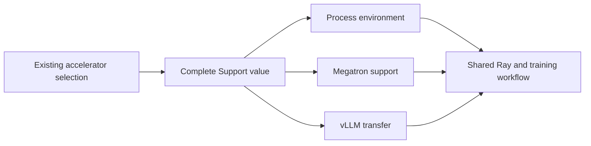

# NPU support: implementation and maintenance

The implementation reuses PR #2 on main `4ad3486c` (M10). Its public workflows
remain main's workflows. One complete support object supplies the environment,
Megatron lifecycle/memory behavior, and vLLM weight transfer implementation.
Hardware acceptance is the next step; CPU checks cannot establish NPU numerical
correctness or communication reliability.

## Start here: what changed

| Responsibility | Read this file first |
|---|---|
| Choose/describe a device; keep main's CUDA/MUSA/SUPA selection | `vime/utils/accelerator/__init__.py` |
| Bind a support factory, validate and publish it once | `vime/utils/support.py` |
| Construct the complete Ascend implementation | `vime_plugins/ascend/__init__.py` |
| Prepare child process environment | `vime/utils/device_env.py`, `vime_plugins/ascend/device_env.py` |
| Fixed training stages and offload | `vime/backends/megatron_support.py`, `vime_plugins/ascend/training.py` |
| Choose transfer backend, trainer info and IPC identity | `vime/backends/vllm_weight_transfer.py`, `vime_plugins/ascend/weight_transfer.py` |
| Own Ray reuse/start, callback and job submission | `vime/utils/external_utils/command_utils.py` |

The separate env/offload/hook registries have been removed. Device selection
keeps its existing registry. `Support` has three explicit components; adding a
platform does not add another public registry or launch algorithm. There is one
default factory binding in `support.py`; custom platforms can use
`VIME_PLUGINS=module`. Factories must construct lightweight objects without
installing runtime patches. They may explicitly choose existing defaults.
Missing components or stale method signatures fail before publication.

Support cannot switch after assembly. The resolved device and factory module
are propagated to child processes; conflicting overrides fail. Successful
Megatron bootstrap runs once. A partially failed vendor patch installation
requires a new process because arbitrary third-party mutations cannot safely
be rolled back.

## s8 to s10: what was carried forward

The comparison uses four fixed trees, not the whole N8-to-N10 diff:

| Tree | Commit |
|---|---|
| M8 | `791f101e20db377b28e15f12a00863baaea2605f` |
| N8 | `cb9437514b3ba9260f4329acdc2cb4c5aa90d788` |
| M10, this branch's base | `4ad3486cb740926fa064df1d3414dccbea3c1939` |
| N10, incremental reference | `3ab462a29d1f3c39e6d59eb1585ba330ed2bf6d5` |
| PR #2, reusable implementation | `f280827666f431e6a94c94ff8cb16dd4df559128` |

Compare `N8 - M8` with `N10 - M10`, then inspect changes in main's callers.
This avoids counting synchronized main code as new NPU work.

| Increment | Result in this branch |
|---|---|
| Trainer factory moved out of `update_weight/common.py` | The real M10 `connect_rollout_engines_from_distributed` calls the transfer component. No patch targets the deleted factory. |
| HCCL needs remote cleanup in mixed IPC/distributed mode | Both NCCL and HCCL use paired shutdown. Reconnection cleans up the engines attached to the old trainer before replacing the binding. |
| Retained serving and unified training entrypoint | Keep M10 `train.py`, Ray liveness/reuse, callback, submission switch and ROCm path. NPU launch code supplies inputs only. Shell examples stop killing sessions automatically. |
| New serving source pins and APIs | Carry N10's reviewed standalone vLLM and vLLM-Ascend patches: HCCL close, disk delta, sampling metadata, GDN and serving lifecycle changes. |
| Pinned NPU Megatron differs from main's vendor pin | Carry the standalone Megatron patch; leave GPU patches untouched. Capability-gate main's automatic per-buffer backup suppression. NPU retains full training-region backup; explicitly requesting unsupported suppression is rejected. |
| MindSpeed / MegatronAdaptor patch bytes | Reuse unchanged N8/N10 patches. Runtime installation now has explicit stages and failures. |
| Image and large-model test changes | Carry N10 constraints, Rust/router build, temporary checkpoint paths and test changes; replace stale `VIME_PLATFORM` uses. Require a fetched source SHA and verify patch/base identity. |

PR model/reward/example additions are retained as separate functionality. They
are not necessary costs of the support assembly mechanism. Their tests and
hardware needs remain separate from its contract tests.

## What to check on the next synchronization

Follow the three component boundaries. For each moved caller, verify the new
function still calls the component at the right stage. Run the tests through
that real function. Do not rely only on a conflict-free merge or source grep.

For a new vendor base, update `docker/npu_patch/versions.json`, Docker source
pins, and the corresponding patch together. Verify clean apply and exact
reverse against pristine source. Runtime CI refuses a different base before
reverting its old patches. The source identity checks cover the framework and
vendor source pins, not byte-for-byte reproducibility of all downloaded tools.

Current GPU defaults include CUDA TMS library search order and all three TMS
environment variables. MUSA/SUPA use their pre-existing main defaults explicitly;
this change does not claim new hardware validation for them.

## Validation order

CPU checks cover complete assembly and failures, fresh-process imports,
resource/environment combinations, the common launcher, actual weight-update
callers, allocator error propagation, checkpoint validation and attention
train/eval arguments. Existing main CPU tests cover model/recovery/serving
behavior. The synthetic third-platform case checks an independent custom
resource with an empty environment; it is not a hardware compatibility claim.

First GPU/NPU acceptance should proceed in this order:

| Case | Minimum observation required |
|---|---|
| One NPU actor + serving child | Same selected backend/factory, correct Ray resource and local device ID; final attention/TE classes match the pin. |
| Tiny dense model, offload disabled | Two forward/backward/optimizer steps; finite loss/gradients and expected parameter changes. |
| Nonzero attention dropout | Train/eval behavior and packed/unpacked numerical comparison, including packed sequence boundaries. |
| IPC, HCCL, then mixed transfer | Two updates each, changed topology, reconnect, and remote cleanup; inference observes the new weight version. |
| Offload repeated three times | Model/optimizer restoration, memory release, and errors surfaced rather than swallowed. |
| Checkpoint round trip | Validation on; model and optimizer match, next step matches; repeat with async/precision-aware options. |
| Trainer restart with retained serving | Same live serving session survives and resumes from the intended weight version. |
| GPU regression | Existing CUDA launch/offload/update/checkpoint case; ROCm smoke where available. |

Only expand to large MoE, multimodal, async, QAT or draft-model cases after these
pass. Alternative MindSpeed feature combinations may change the actual TE
classes; check them separately. The s10 sample validates one known evolution;
it does not guarantee every future upstream change will be compatible.
